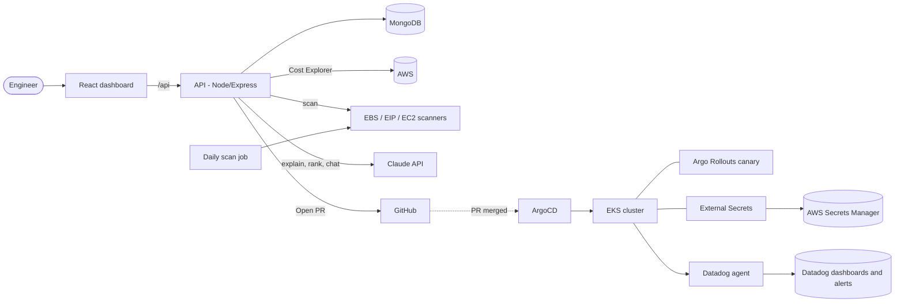

# CostPilot

**An AI-powered FinOps platform for AWS. It finds wasted spend, explains it in plain English with Claude, and opens pull requests that fix it. Every change goes through Git, a review, and a canary release.**


-4a4fcf)


## What it does
1. **Shows your AWS spend**: daily totals, a month-end forecast against your budget, spend by service, and the unusual days.
2. **Explains a spike**: "Explain this" writes the likely causes and what to check, from your own numbers.
3. **Finds waste**: unattached disks, unused Elastic IPs and idle servers, each with an estimated monthly saving.
4. **Ranks the fixes**: Claude orders them by saving, risk and effort.
5. **Opens a pull request**: a runbook with the check, fix and undo commands. Merging it does not change AWS. A person applies the fix.
6. **Ships safely**: a canary release that rolls back on its own if the health check fails.

## Architecture



A longer walkthrough, with the CI/CD flow, is in [docs/architecture.md](docs/architecture.md).

## How a change reaches production
```
merge to main
  -> GitHub Actions: tests, Terraform and Helm checks, image build, security scan, push to ECR
  -> Jenkins: promote the image tag (writes it to gitops/envs/<env>/values.yaml)
  -> ArgoCD: deploys that commit as a canary
  -> smoke test inside the cluster; failure marks the release as failed
```
Each tool does one job. Nothing is deployed by hand.

## Tech stack
| Area | Tools |
|---|---|
| App | React (Vite), Node.js, Express, MongoDB (Mongoose), Claude API |
| Cloud | AWS EKS, ECR, S3, SQS, IAM (IRSA), Secrets Manager, Cost Explorer, EC2, CloudWatch |
| Infrastructure | Terraform (modules, S3 state with locking), OpenTofu-compatible |
| Containers | Docker, Helm |
| Delivery | GitHub Actions (CI), Jenkins (promotion), ArgoCD (GitOps), Argo Rollouts (canary) |
| Security | Trivy scan, IRSA, KMS-encrypted secrets, Secrets Manager, least-privilege IAM |
| Observability | Datadog agent, OpenMetrics, logs, dashboards, monitors |

## Repository layout
```
backend/            API, scanners, AI services, scan job, smoke test, tests
frontend/           React dashboard
gitops/
  charts/costpilot/ Helm chart (API as Rollout, web, database, scan job, smoke test)
  envs/dev|prod/    the image tag and settings per environment (Jenkins writes the tag)
  apps/             ArgoCD Applications for the app
  platform/         ArgoCD Applications for External Secrets, Argo Rollouts, Datadog
terraform/          bootstrap (state), modules (vpc, eks, ecr, s3, sqs, iam, budget, app-secrets, github-oidc), envs
.github/workflows/  CI
jenkins/            local Jenkins for the promotion job
docs/               architecture, ADRs, runbooks, weekly guides, demo script
scripts/            PowerShell helpers for Windows
```

## Run it on your PC (no AWS needed)
```bash
cp .env.example .env
docker compose up -d --build
```
Open the port shown by `docker ps` for the frontend. The app uses sample data until you switch `COST_SOURCE=aws`.

Run the tests:
```bash
cd backend && npm install && npm test
```

## Run it on AWS
Follow the weekly guides in order. Each one ends with a checkpoint.
1. [Week 4: Terraform builds the cluster](docs/week4.md)
2. [Week 5: Helm and ArgoCD deploy the app](docs/week5.md)
3. [Week 6: GitHub Actions, Jenkins and pull requests](docs/week6.md)
4. [Week 7: Datadog, secrets from AWS, canary releases](docs/week7.md)

**Cost:** an EKS cluster with two nodes and a NAT gateway costs roughly $5 to $8 a day. Run `terraform destroy` in `terraform/envs/dev` when you stop.

## Decisions
The reasoning behind the big choices is in [docs/adr](docs/adr). Start with [ADR 0001](docs/adr/0001-eks-over-ecs.md).

## Operations
- [Runbooks](docs/runbooks): what to do when an alert fires, a deploy fails, or a scan job breaks.
- Datadog dashboard and monitors: `gitops/platform/datadog/`.

## Security
- No AWS access keys are stored. GitHub Actions and the pods use short-lived roles.
- Secrets live in AWS Secrets Manager, and are copied into the cluster by External Secrets.
- The AI only advises. It has no AWS access, and AWS names and tags are treated as data, not instructions.
- Pull requests from the app only add a runbook file. Nothing changes in AWS until a person applies it.

## Status
| Week | Topic | Status |
|---|---|---|
| 1 | Dashboard, auth, Docker Compose | Done |
| 2 | Real AWS cost data, waste scanners, savings | Done |
| 3 | Claude: explain, rank, chat | Done |
| 4 | Terraform: VPC, EKS, ECR, SQS, IAM | Done |
| 5 | Helm chart and ArgoCD | Done |
| 6 | GitHub Actions, Jenkins promotion, pull requests | Done |
| 7 | Datadog, secrets from AWS, canary releases | In progress |
| 8 | Documentation and polish | Done |

## Demo
See [docs/demo-script.md](docs/demo-script.md) for a five-minute walkthrough.

## Author
Yash Deshpande. Built as a portfolio project for DevOps and platform roles.
