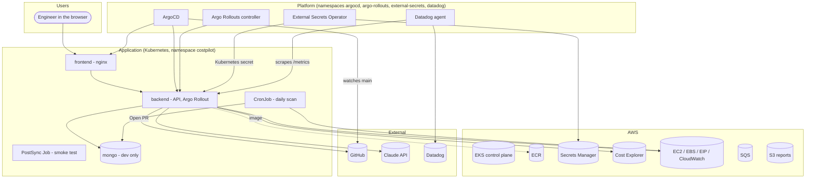
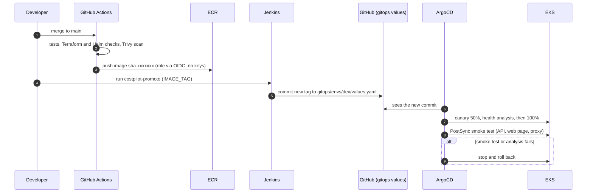

# Architecture

## The system in one picture

## The delivery path

## Where each secret lives
| Secret | Stored in | Read by | Never |
|---|---|---|---|
| App keys (JWT, Mongo URI, Claude, GitHub token) | Secrets Manager `costpilot-<env>/app` | External Secrets, then the API pods | In Git, in Terraform state, in logs |
| Datadog keys | Secrets Manager `costpilot-<env>/datadog` | External Secrets, then the agent | In Git |
| AWS access for pods | IAM roles (IRSA), no keys | API and scan pods | Anywhere |
| AWS access for CI | GitHub OIDC role | GitHub Actions | Anywhere |

## Trust boundaries
- The AI reads a summary of the bill and can only advise. It cannot call AWS.
- Pull requests from the app add a runbook file. Merging changes nothing in AWS.
- Each service account can assume only its own role, and only in its own namespace.
- The web app does not expose `/metrics` or any admin route.

## Environments
| | dev | prod |
|---|---|---|
| Nodes | 1 to 2 (on-demand m7i-flex.large) | 3 to 6 across 3 zones |
| NAT | one shared | one per zone |
| Database | in-cluster throwaway | MongoDB Atlas (planned) |
| Cost source | sample data (switch to aws when ready) | AWS Cost Explorer |
| Secret store | Secrets Manager | Secrets Manager |
| Prod cluster | not needed for the learning path | described, not applied |
